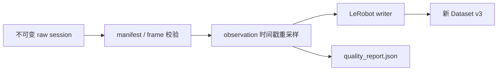

# 架构与数据流

## 离线边界

CLI 调用 `convert_session()`：读取 manifest，按文件名排序正式 episode，全部校验和重采样后才创建 writer，随后逐集 `add_frame()`、`save_episode()`，最后 `finalize()` 并写报告。当前会将所有已准备 episode 保存在内存中，处理大 session 时需要预留内存。

基础校验使用标准库，实际 writer 延迟导入 LeRobot；转换时 NumPy 构造 float32 向量。输入/输出路径相对于调用时目录解析后转为绝对路径。转换不修改 raw、不连接设备、不自动上传 Hugging Face Hub。

## 时间对齐规则

每集从首个 `observation_time_ns` 建立等间隔目标轴：帧数为 `floor((last_ns - first_ns) × fps / 1e9) + 1`。每个目标时刻选择最近的原始 observation，等距时选较早帧；action 和其他反馈整组取自同一原始行，不单独匹配或插值。

因此不同目标时刻可能重复选择同一帧。原始约 50 Hz 转 30 FPS 不采用每两帧抽一帧。LeRobot 按目标 FPS 生成新的 episode 时间戳，原始纳秒时间戳不会写入当前 feature，必须保留 raw 以供追溯。

controller raw 中 observation 是 action 下发后的反馈。转换器保持这对关系，不推断机器人执行延迟，也不将其改成动作前状态。此语义应在训练使用前评估。

## API 与扩展

- `prepare_episode(path, fps=30)`：单集解析、校验和重采样，不写数据集。
- `convert_session(session, output, repo_id="local/demo", fps=30)`：校验整个 session 并写数据集。
- `dataset_factory`：测试注入实现 `DatasetProtocol` 的 writer。

raw v1 保持 `use_videos=False`；v2 在创建 writer 前校验所有图像及每路时间匹配。RGB、深度分别对上述同一目标轴取最近帧；不得按帧号或按重采样后的关节时间再次建立另一条轴。`max_camera_skew_ms=None` 使用 manifest 的每路容差，正有限显式值覆盖它。图像路径仅保留索引，写帧时逐张加载，不将整集像素常驻内存。

RGB 为 MP4 video；深度为带 is_depth_map/depth_unit=m 的 image，以米制 float32 TIFF 嵌入 Parquet，避免深度视频量化。深度单位、内外参和独立时间来源由采集端声明；本库不导入 RealSense、不做硬件授时或空间配准。

## 文档导航

- [安装](installation.md)
- [CLI](reference/cli.md)
- [Raw v1/v2](reference/raw-format.md)
- [输出与报告](reference/output.md)
- [配置](reference/config.md)
- [排障](reference/errors.md)
- [贡献指南](../CONTRIBUTING.md)
- [许可状态](../LICENSE)
