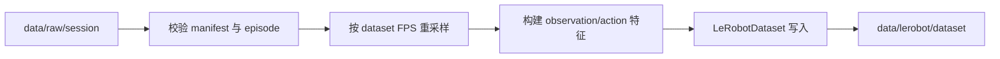

# 架构与数据流

lerobot-converter 把 CR7 跟随产生的 raw session 转换成 LeRobot Dataset v3。
它只读取 raw，不访问机械臂、主臂或相机，也不是实时控制环境的一部分。



## 输入

```
session/
├── manifest.json
└── episodes/
    ├── episode_000000.jsonl
    └── ...
```

manifest 声明格式版本、任务、控制频率、关节名称、单位和夹爪范围。
episode 行包含时间戳、七维 action、七维关节位置/速度和夹爪反馈。

## 处理

1. 校验 manifest、行序号、有限数值和时间单调性。
2. 以首行 `observation_time_ns` 为起点，按 `fps` 建立目标时间轴。
3. 关节整行取最近时间；action 与 observation 保持同一原始行。
4. 可选写入速度和末端位姿特征。
5. 通过官方 `LeRobotDataset` 写入 v3。

## 输出

- `observation.state`：七维关节状态。
- `action`：七维目标。
- 可选 `observation.velocity`、`observation.ee_pose`。
- 若 raw 带相机图像，由 CR7 适配层另行处理；本包不生成图像。

## 边界

- 目标目录必须尚不存在。
- 转换失败不修改 raw；已保存的 episode 可以稍后重试。
- 不把 `.partial` 片段当作完整 episode。
